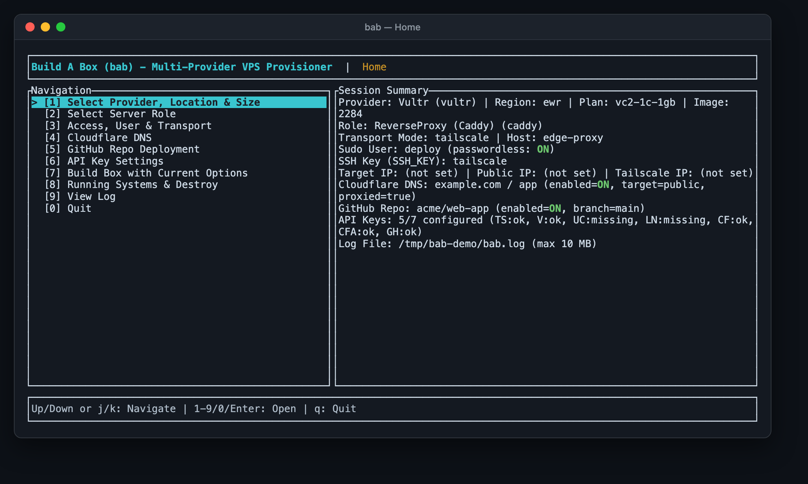
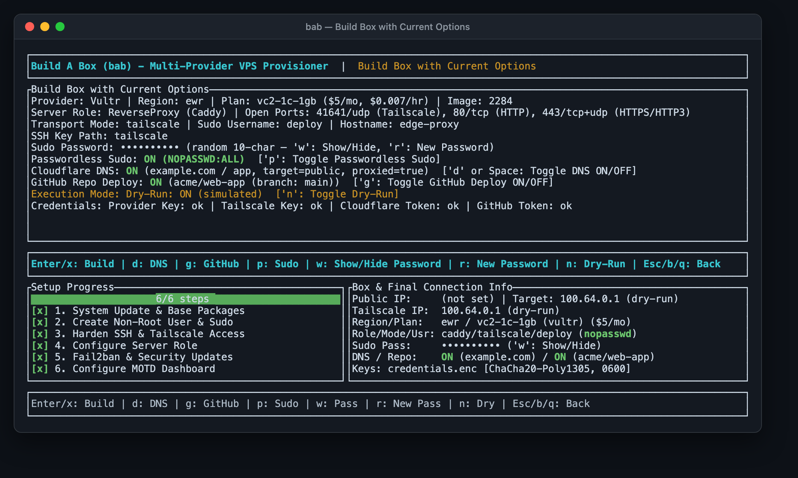

# bab (Build A Box)

`bab` is a Rust CLI and terminal UI for spinning up, locking down, and tearing down Linux VPS boxes on Vultr, UpCloud, and Akamai/Linode.

Instead of clicking around cloud dashboards or juggling half a dozen bootstrap scripts, `bab` handles creating the VM, setting up your user and firewall, locking down SSH or joining Tailscale, optionally deploying a repo, keeping an eye on what a box is costing you, and cleaning everything up when you're done.

## Quick start

```bash
cargo build --release
./target/release/bab
```

Run `bab` on its own for the TUI, or pass subcommands (`bab --help`) when you want to script things.





## What it handles

**Clouds & access** — Works with **Vultr**, **UpCloud**, and **Linode**, or against an existing machine (`--provider existing`), or you can just print standalone `cloud-init` scripts. You get two ways in:

- **Tailscale SSH** *(default)* — grabs an auth key from the Tailscale API, joins your tailnet on boot, turns on Tailscale SSH, and leaves public port `22` closed.
- **Standard SSH** — creates or reuses `~/.ssh/bab_ed25519`, locks down `sshd` (no root login or passwords), rate-limits port `22`, and enables Fail2ban.

The Vultr client tries IPv4 first and falls back to dual-stack if needed, so IP-allowlisted keys don't randomly bounce with `401` errors on dual-stack machines.

**Server roles** — Pick what goes on the box:

- `vanilla` — base updates, non-root `sudo` user, locked-down SSH/Tailscale, `ufw`/`firewalld`, Fail2ban, and unattended security updates.
- `caddy` — Docker + Caddy (`80/tcp`, `443/tcp+udp`) with container-safe firewall rules.
- `wireguard` — WireGuard VPN (`51820/udp`) with IP forwarding, NAT, and ready-to-use server and `client1` configs.
- `rbi` — stub for Remote Browser Isolation (not built yet).

*Note: Cloudflare DNS is also just a plan/dry-run stub for now.*

**Spinning up multiple boxes** — Building again always creates a brand-new server instead of stepping on an existing one. If your hostname is already taken on your cloud account or online in Tailscale, `bab` bumps it to `-2`, `-3`, etc. and rolls a fresh 10-character sudo password. Passwordless sudo (`NOPASSWD:ALL`) is on by default, and you can flip it off anytime.

**Cost tracking & teardown** — You can check live VMs across all your configured providers with hourly/monthly rates and estimated accrued spend. Destroying a box makes you explicitly hit `y` so you don't nuke anything by accident, stops active UpCloud boxes before deleting them, and removes matching nodes from Tailscale automatically when `TAILSCALE_API_KEY` is set.

**Live key checks** — You can paste API keys straight into the settings screen or save them via CLI, then test them against the live APIs (`bab settings --test`). If you're using a scoped `cfat_*` Cloudflare Account token, add your `CLOUDFLARE_ACCOUNT_ID` too so it verifies against `/accounts/<id>/tokens/verify`.

## CLI examples

```bash
# Save API keys (encrypted locally) and test them against live APIs
bab settings \
  --tailscale-key tskey-api-... \
  --vultr-key ... \
  --linode-token ... \
  --upcloud-token ... \
  --cloudflare-token ... \
  --cloudflare-account-id ... \
  --github-token ...

bab settings --show
bab settings --test

# Check cached presets or fetch live regions, plans, and images
bab catalog --provider vultr
bab catalog --provider linode --live

# See available roles and which ports they open
bab roles
bab roles --transport ssh

# Spin up a hardened Vanilla box over Standard SSH
bab setup \
  --provider vultr \
  --region ewr \
  --plan vc2-1c-1gb \
  --image 2284 \
  --role vanilla \
  --transport ssh \
  --generate-ssh-key \
  --user myadmin \
  --hostname my-vanilla-box

# Spin up a Caddy proxy over Tailscale with GitHub deploy and Cloudflare DNS stub
bab setup \
  --provider linode \
  --region us-east \
  --plan g6-nanode-1 \
  --role caddy \
  --transport tailscale \
  --user deploy \
  --hostname edge-proxy \
  --github-repo owner/app \
  --github-branch main \
  --cf-zone example.com \
  --cf-record app \
  --cf-proxied

# Flip saved DNS, GitHub deploy, or passwordless sudo off for a single run
bab setup --provider existing --no-cf-dns --no-github-deploy --no-sudo-nopasswd --dry-run

# Deploy/update a repo or plan a Cloudflare A-record on the active box
bab deploy --repo owner/app --branch main --path /home/deploy/apps/app --cmd "docker compose up -d --build"
bab dns --zone example.com --record app --proxied

# List running boxes (aliases: ps, list) or tear one down (aliases: rm, delete)
bab instances
bab ps --provider vultr --all
bab destroy --id vultr-inst-1 --provider vultr --dry-run
bab destroy --id vultr-inst-1 --yes
bab instances --destroy upcloud-uuid-1 -y

# Print standalone cloud-init scripts or check on the active box
bab cloud-init --hostname my-box --user myadmin
bab cloud-init --transport ssh --generate-ssh-key --hostname my-box --user myadmin
bab status
```

## Where stuff lives

Everything is stored under `~/.config/bab/` (`0700`, override with `BAB_CONFIG_DIR`):

- `credentials.enc` (`0600`) — `ChaCha20-Poly1305` encrypted API keys and per-box sudo passwords (`BAB_SETTINGS_FILE` overrides this). Any matching env vars in your shell get auto-saved here encrypted on startup.
- `master.key` (`0600`) — auto-generated 256-bit key for `credentials.enc` (override with `BAB_MASTER_KEY_FILE`, or set `BAB_ENCRYPTION_KEY` to derive from a passphrase instead).
- `state.conf` (`0600`) — active box IPs, provider settings, user/transport picks, and toggle flags (`BAB_STATE_FILE`).
- `bab.log` (`0600`) — timestamped log shared by the TUI and CLI, capped at 10 MB (`BAB_LOG_FILE`).

If you want to swap in custom SSH binaries or mocks for testing, set `BAB_SSH_BIN`, `BAB_SCP_BIN`, or `BAB_SSH_KEYGEN_BIN`.

## Tests

```bash
cargo clippy --all-targets -- -D warnings
RUSTFLAGS="-D warnings" cargo test
```
